# SCPMS: Smart Campus Placement Management System

A multi-university campus placement platform that connects **Super Admins, University Admins, Companies and Students** across the full recruitment lifecycle: company onboarding, university authorization, job distribution, student applications, interview scheduling and offer tracking, with real-time and email notifications.

---

## Table of Contents

1. [Key Features](#key-features)
2. [Tech Stack](#tech-stack)
3. [System Architecture](#system-architecture)
4. [Roles and Access Control (RBAC)](#roles-and-access-control-rbac)
5. [Module Flows](#module-flows)
   - [Authentication and Session Management](#1-authentication-and-session-management)
   - [Password Reset with OTP](#2-password-reset-with-otp)
   - [Company Onboarding and University Authorization](#3-company-onboarding-and-university-authorization)
   - [Job Distribution (Job and JobUniversity)](#4-job-distribution-job--jobuniversity)
   - [Student Applications](#5-student-applications)
   - [Interview Scheduling](#6-interview-scheduling)
   - [Notifications](#7-notifications)
   - [Bulk Email and Dashboard](#8-bulk-email-and-dashboard)
   - [File Uploads](#9-file-uploads-cloudinary)
6. [Database Design](#database-design)
7. [API Reference](#api-reference)
8. [Project Structure](#project-structure)
9. [Getting Started](#getting-started)
10. [Environment Variables](#environment-variables)
11. [Scripts](#scripts)
12. [Known Issues and To Be Confirmed](#known-issues-and-to-be-confirmed)

---

## Key Features

- **Four-role RBAC**: `SUPER_ADMIN`, `ADMIN` (University Admin), `COMPANY`, `STUDENT`.
- **JWT authentication** with short-lived access tokens and refresh tokens stored in the database (revocable on logout).
- **OTP-based password reset**, with expiry, resend limit and attempt limit.
- **Two-level company approval**: platform activation, then per-university authorization.
- **University-specific job offerings**: one company job can be sent to many universities, each with its own salary, eligibility, openings and approval status.
- **Student applications** with eligibility checks, status history, interview rounds and offer accept/reject.
- **Interview scheduling** with job linking, company approval and a discussion thread.
- **Real-time notifications** (Socket.IO) with persistent in-app notifications.
- **Email**: Nodemailer (SMTP) for schedule discussions and bulk mailing.
- **Direct-to-Cloudinary uploads** using server-signed upload signatures.
- **Admin dashboard stats**, bulk mail, and soft-deleted jobs.

---

## Tech Stack

| Layer | Technology |
|---|---|
| Runtime | Node.js |
| Language | TypeScript (run with `tsx`, built with `tsc` + `tsc-alias`) |
| Framework | Express 5 |
| ORM | Prisma 5.22 |
| Database | PostgreSQL (`pg`); local or cloud (Neon) switchable via `DB_PROVIDER` |
| Auth | JSON Web Tokens (`jsonwebtoken`), `bcrypt`, `cookie-parser` |
| Validation | Zod 4 |
| Real-time | Socket.IO 4 |
| Email | Nodemailer (SMTP) |
| File storage | Cloudinary (signed direct upload) |
| Other | `cors`, `dotenv` |

---

## System Architecture

The backend follows a **layered architecture**. Each request passes through authentication, activity and role checks, then validation, before reaching business logic.

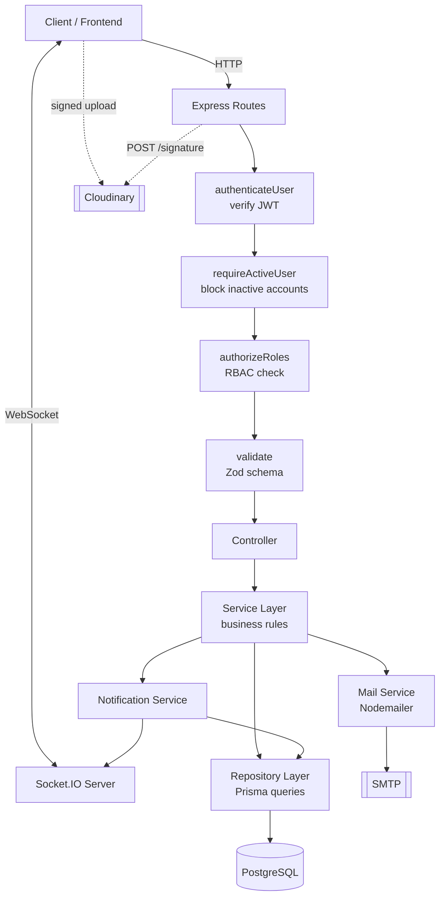

| Layer | Responsibility |
|---|---|
| **Routes** | Define endpoints and attach the middleware chain. |
| **Middleware** | `authenticateUser`, `requireActiveUser`, `authorizeRoles`, `validate`. |
| **Controllers** | Read request data and the authenticated user (`res.locals.user`), call services, and return responses with `sendSuccess` / `sendError`. |
| **Services** | Business rules, eligibility checks, notification and email orchestration. |
| **Repositories** | All Prisma database access, kept separate from business logic. |

---

## Roles and Access Control (RBAC)

Access is enforced by a three-step middleware chain on protected routes:

```text
authenticateUser  ->  requireActiveUser  ->  authorizeRoles("ROLE", ...)
```

| Middleware | Purpose |
|---|---|
| `authenticateUser` | Verifies the JWT and identifies the user. |
| `requireActiveUser` | Rejects users whose `status` is not `ACTIVE`. New users start as `INACTIVE`. |
| `authorizeRoles(...)` | Restricts the route to the listed roles. |

### Roles

| Role | Scope | Main responsibilities |
|---|---|---|
| `SUPER_ADMIN` | Platform | Manage admins (activate/deactivate), companies, view universities. Created via seed script. |
| `ADMIN` | One university (`Admin.universityId`) | Manage the university's students and company requests, approve job offerings, create interview schedules, bulk mail, dashboard. |
| `COMPANY` | Own company | Maintain profile, request university access, post jobs, send jobs to universities, review applications, approve schedules. |
| `STUDENT` | Own data | Maintain profile, browse jobs, apply, track applications, respond to offers. |

### Permission matrix (derived from route definitions)

| Capability | SUPER_ADMIN | ADMIN | COMPANY | STUDENT |
|---|:-:|:-:|:-:|:-:|
| Activate / deactivate admins | Yes | | | |
| List admins, companies, universities | Yes | | | |
| Activate companies | Yes | Yes | | |
| Activate users, list students / companies of the university | | Yes | | |
| Approve / reject company-university requests | | Yes | | |
| Approve / reject job offerings (JobUniversity) | | Yes | | |
| Create / edit / delete interview schedules | | Yes | | |
| Approve / reject a schedule | | | Yes | |
| Send bulk email, view dashboard | | Yes | | |
| Manage departments and skills | | Yes | | |
| Request university access, reapply | | | Yes | |
| Post / update jobs, send jobs to universities | | | Yes | |
| Update application status | | Yes | Yes | |
| Apply to jobs, respond to offers | | | | Yes |
| View a schedule by id | | Yes | Yes | Yes |

---

## Module Flows

### 1. Authentication and Session Management

- Registration is role-specific: `POST /user/register` (student/company users), `POST /admin/register`, `POST /superadmin/register`.
- Passwords are hashed with **bcrypt** (`SALT_ROUNDS`).
- **Access token** lifetime comes from `JWT_ACCESS_TTL` (default `15m`). **Refresh token** lifetime comes from `JWT_REFRESH_TTL` (default `1d`). Refresh tokens are stored in the `Token` table, so they can be revoked.
- The middleware reads the access token from the `Authorization: Bearer` header or from cookies.

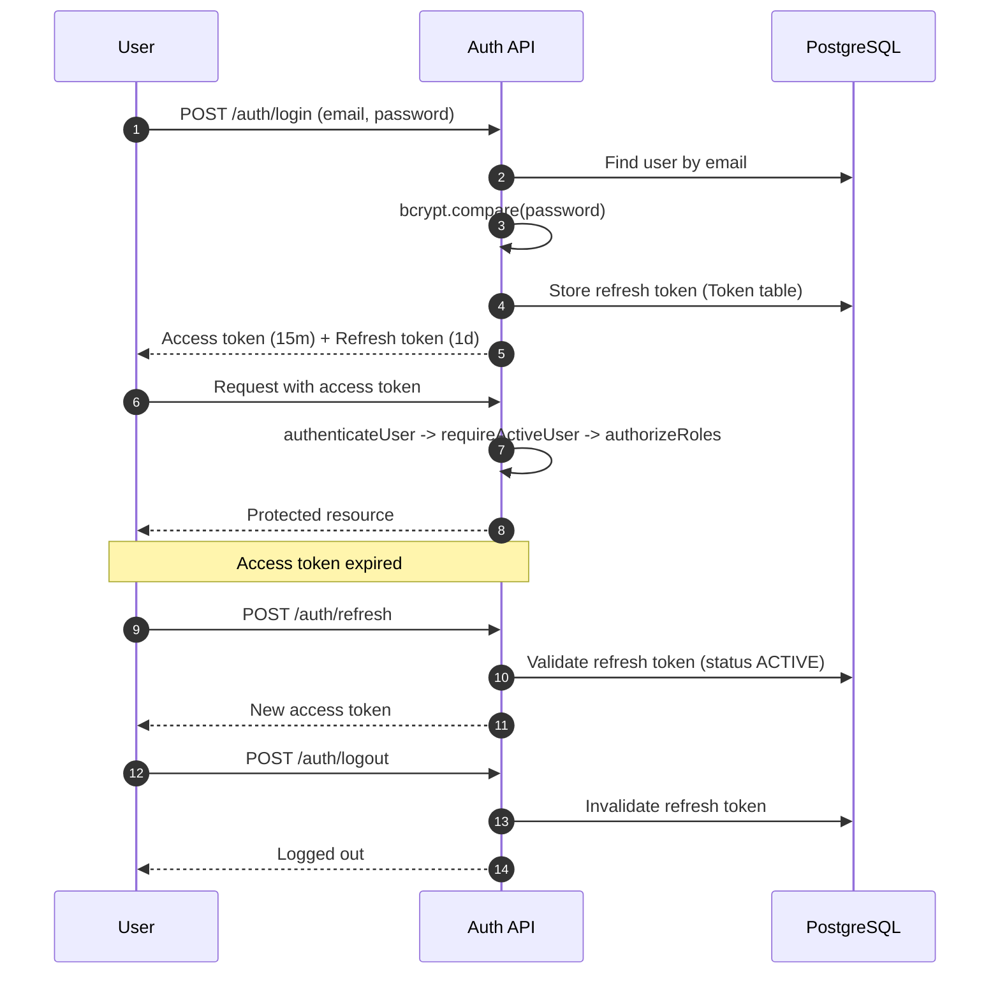

### 2. Password Reset with OTP

OTP is used for **forgot / reset password** only. OTP state lives on the `User` row (`otp`, `otpExpiry`, `otpAttempts`, `otpGenerations`).

| Setting | Env variable | Default in `.env` |
|---|---|---|
| OTP validity | `OTP_EXPIRY_MINUTES` | 5 |
| Max OTP generations | `OTP_MAX_GENERATIONS` | 5 |
| Max wrong attempts | `OTP_MAX_ATTEMPTS` | 5 |

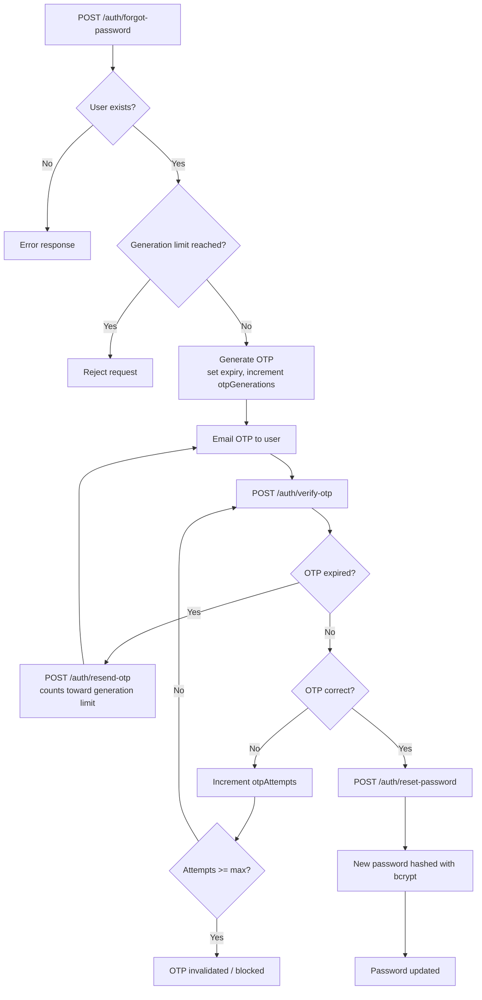

### 3. Company Onboarding and University Authorization

A company must pass **two independent gates**: being active on the platform, and being approved by each university it wants to recruit from.

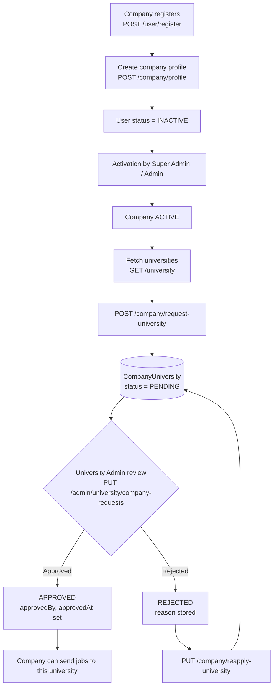

> Platform activation and university authorization are different. An active company still needs `APPROVED` status for each university before it can distribute jobs there.

### 4. Job Distribution (Job and JobUniversity)

A **Job** is the general role created by a company. A **JobUniversity** is that job offered to one university, with its own salary, eligibility and approval status.

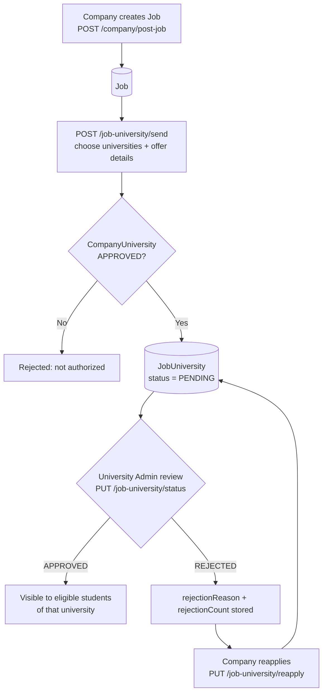

Per-university fields on `JobUniversity`: `salary`, `description`, `minCgpa`, `maxBacklogs`, `openings`, `sentAt`, `approvedAt`, `rejectedAt`, `rejectionReason`, `rejectionCount`. A job can be sent to a given university only once (`@@unique([jobId, universityId])`); rejected offerings go through the reapply flow.

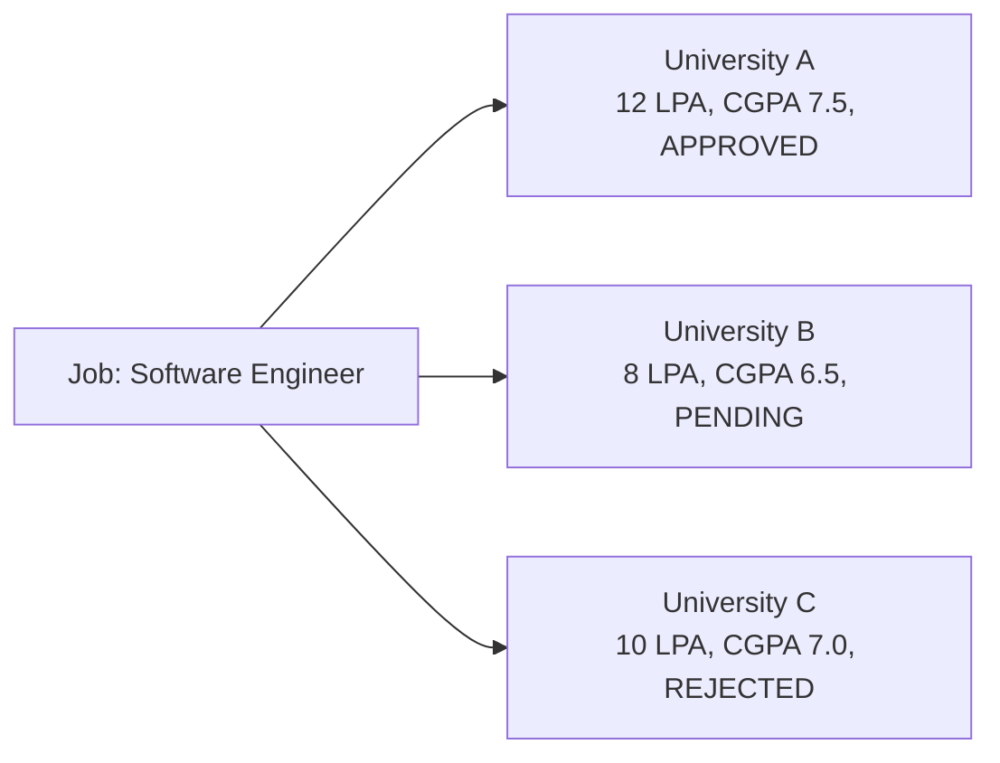

### 5. Student Applications

Applications reference a **JobUniversity**, not a bare Job (`@@unique([studentId, jobUniversityId])` prevents duplicates).

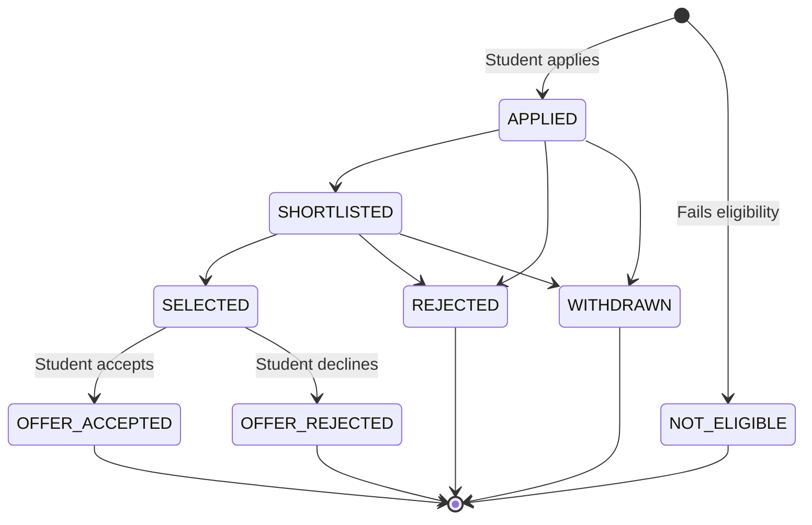

> The statuses come from the `ApplicationStatus` enum. The transitions above show the typical progression; the services enforce the exact rules.

Every status change is recorded in `ApplicationStatusHistory` (status, round, reason, `createdBy`). The current interview round is tracked in `Application.currentRound`:
`APTITUDE`, `GROUP_DISCUSSION`, `HR`, `TECHNICAL`, `MANAGERIAL`, `FINAL`.

Student journey: `GET /student/show-all-jobs` → `POST /student/apply-job` → `GET /student/get-job-application` → `PUT /student/application/:applicationId/offer-response`.

### 6. Interview Scheduling

Schedules are created by a **University Admin** for a company and approved by the **Company**.

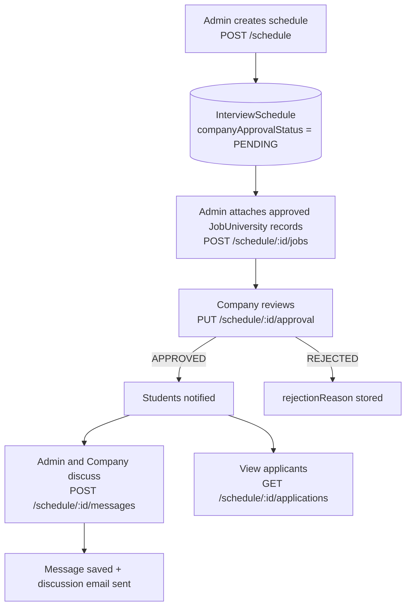

Schedule fields include `title`, `startTime`, `endTime`, `venue`, `status` (`SCHEDULED`, `ONGOING`, `COMPLETED`, `CANCELLED`), `companyApprovalStatus`, `createdBy` (Admin) and `universityId`. Jobs are linked through `JobUniversity.interviewScheduleId`.

### 7. Notifications

Notifications use two channels:

1. **Real-time**: Socket.IO pushes events to connected users.
2. **Persistent**: each notification is stored in the `Notification` table (`read` flag), so users can see it later.

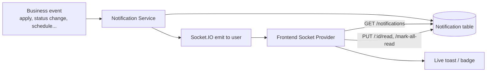

Supported notification types (`NotificationType`): `APPLICATION_SUBMITTED`, `APPLICATION_SHORTLISTED`, `APPLICATION_SELECTED`, `APPLICATION_REJECTED`, `APPLICATION_WITHDRAWN`, `JOB_POSTED`, `JOB_UPDATED`, `JOB_ALERT`, `SCHEDULE_CREATED`, `SCHEDULE_UPDATED`, `SCHEDULE_APPROVED`, `OFFER_ACCEPTED`, `OFFER_REJECTED`, `SYSTEM`.

REST endpoints: list, unread count, mark one / all read, delete, and `upcoming-events`.

### 8. Bulk Email and Dashboard

- `POST /admin/send-mails`: a University Admin sends an email to selected recipients. Emails are sent through the Nodemailer mail service.
- `GET /admin/dashboard`: aggregated placement statistics for the admin.

### 9. File Uploads (Cloudinary)

Files (for example resumes) are uploaded **directly from the frontend to Cloudinary**. The backend only issues a signature, so no file passes through the API server.

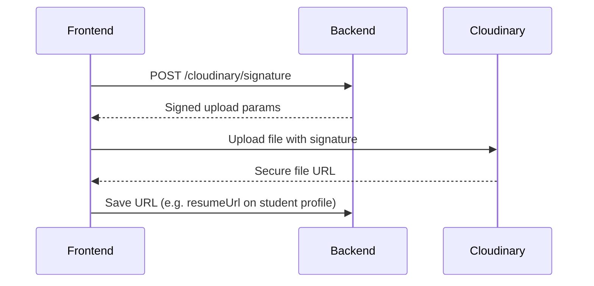

---

## Database Design

PostgreSQL schema managed with Prisma.

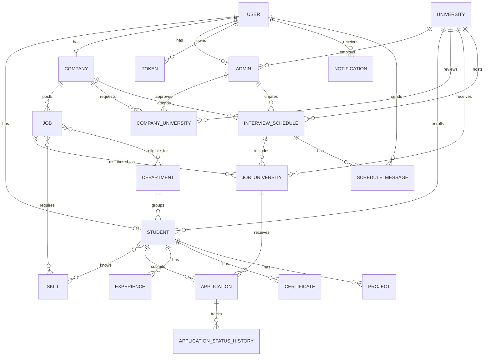

### Core models

| Model | Purpose |
|---|---|
| `User` | Login identity, role, status, and password-reset OTP state. |
| `Token` | Refresh tokens (revocable). |
| `Student` | Academic profile (CGPA, backlogs, placement status, links, resume). |
| `Company` / `Admin` / `University` | Company profile, university admin, and tenant institution. |
| `CompanyUniversity` | Company ↔ university authorization (`PENDING / APPROVED / REJECTED`). |
| `Job` | General role by a company (soft delete via `isDeleted`). |
| `JobUniversity` | University-specific offering with its own approval and eligibility. |
| `Application` / `ApplicationStatusHistory` | A student's application and its audit trail. |
| `InterviewSchedule` / `ScheduleMessage` | Interview slots and the discussion thread. |
| `Notification` | Persistent in-app notifications. |
| `Skill`, `Department`, `Experience`, `Certificate`, `Project` | Supporting data. |

---

## API Reference

> Paths are listed **relative to each router's mount prefix**, which is defined where the routers are registered in the app entry file. All protected routes use `authenticateUser`; "Active" means `requireActiveUser` is also applied.

### Auth (`/auth`)

| Method | Path | Access | Description |
|---|---|---|---|
| POST | `/login` | Public | Login with email and password |
| POST | `/refresh` | Public | Issue a new access token |
| POST | `/logout` | Authenticated | Invalidate the session |
| POST | `/forgot-password` | Public | Send a reset OTP |
| POST | `/resend-otp` | Public | Resend the OTP |
| POST | `/verify-otp` | Public | Verify the OTP |
| POST | `/reset-password` | Public | Set a new password |

### User (`/user`)

| Method | Path | Access | Description |
|---|---|---|---|
| POST | `/register` | Public | Register a user |
| GET | `/fetch` | Authenticated | Get the current user |
| PUT | `/update` | Authenticated | Update the current user |

### Super Admin (`/superadmin`)

| Method | Path | Access | Description |
|---|---|---|---|
| POST | `/register` | Public | Create a super admin |
| GET | `/admins` | SUPER_ADMIN, Active | List admins |
| PUT | `/admins/activate` | SUPER_ADMIN, Active | Activate admins |
| PUT | `/admins/deactivate` | SUPER_ADMIN, Active | Deactivate admins |
| GET | `/companies` | SUPER_ADMIN, Active | List companies |
| PUT | `/companies/activate` | SUPER_ADMIN, Active | Activate companies |
| GET | `/universities` | SUPER_ADMIN, Active | List universities |
| GET | `/` , `/:id` | Public | List / fetch super admins |
| PUT | `/:id` | SUPER_ADMIN, Active | Update a super admin |
| DELETE | `/:id` | SUPER_ADMIN, Active | Delete a super admin |

### Admin / University Admin (`/admin`)

| Method | Path | Access | Description |
|---|---|---|---|
| POST | `/register` | Public | Register a university admin |
| GET | `/get-students` | ADMIN, Active | List students |
| GET | `/get-inactive-students` | ADMIN, Active | List inactive students |
| GET | `/get-companies` | ADMIN, Active | List companies |
| GET | `/get-inactive-companies` | ADMIN, Active | List inactive companies |
| PUT | `/activate-users` | ADMIN, Active | Activate users |
| PUT | `/activate-companies` | ADMIN, Active | Activate companies |
| GET | `/university/company-requests` | ADMIN, Active | View company access requests |
| PUT | `/university/company-requests` | ADMIN, Active | Approve / reject requests |
| GET | `/jobs` | ADMIN, Active | List jobs |
| GET | `/get-jobs-company/:id` | ADMIN, Active | Jobs of a company |
| GET | `/applications` | ADMIN, Active | List applications |
| PUT | `/applications/:id` | ADMIN, Active | Update application status |
| GET | `/dashboard` | ADMIN, Active | Dashboard statistics |
| POST | `/send-mails` | ADMIN, Active | Send bulk email |

### Company (`/company`)

| Method | Path | Access | Description |
|---|---|---|---|
| POST | `/profile` | COMPANY | Create company profile |
| GET | `/profile` | COMPANY | Get company profile |
| PUT | `/profile` | COMPANY, Active | Update company profile |
| POST | `/request-university` | COMPANY, Active | Request university access |
| GET | `/requests` | COMPANY, Active | View request statuses |
| PUT | `/reapply-university` | COMPANY, Active | Reapply after rejection |
| POST | `/post-job` | COMPANY, Active | Create a job |
| PUT | `/post-job/:id` | COMPANY, Active | Update a job |
| GET | `/get-jobs` | COMPANY, Active | List own jobs |
| GET | `/get-job-application` | COMPANY, Active | Applications for own jobs |
| PUT | `/update-job-status/:id` | COMPANY, Active | Update application status |

### Job University (`/job-university`)

| Method | Path | Access | Description |
|---|---|---|---|
| POST | `/send` | COMPANY, Active | Send a job to universities |
| PUT | `/status` | ADMIN, Active | Approve / reject an offering |
| PUT | `/reapply` | COMPANY, Active | Reapply a rejected offering |
| GET | `/` | Authenticated, Active | List offerings |

### Student (`/student`)

| Method | Path | Access | Description |
|---|---|---|---|
| POST | `/profile` | STUDENT | Create profile |
| GET | `/profile` | STUDENT | Get profile |
| PUT | `/profile` | STUDENT, Active | Update profile |
| GET | `/show-all-jobs` | STUDENT, Active | Browse jobs |
| POST | `/apply-job` | STUDENT, Active | Apply to a job offering |
| GET | `/get-job-application` | STUDENT, Active | Own applications |
| PUT | `/application/:applicationId/offer-response` | STUDENT, Active | Accept / reject an offer |

### Interview Schedules (`/schedule`)

| Method | Path | Access | Description |
|---|---|---|---|
| POST | `/` | ADMIN, Active | Create schedule |
| GET | `/` | ADMIN / COMPANY, Active | List schedules |
| GET | `/company` | COMPANY, Active | Company's schedules |
| GET | `/by-company-id` | ADMIN / COMPANY, Active | Schedules for a company |
| GET | `/:id` | ADMIN / COMPANY / STUDENT, Active | Schedule details |
| PUT | `/:id` | ADMIN, Active | Update schedule |
| DELETE | `/:id` | ADMIN, Active | Delete schedule |
| POST | `/:id/jobs` | ADMIN, Active | Add jobs to schedule |
| DELETE | `/jobs` | ADMIN, Active | Remove jobs from schedule |
| PUT | `/:id/approval` | COMPANY, Active | Approve / reject schedule |
| GET | `/:id/applications` | ADMIN / COMPANY, Active | Applicants for the schedule |
| POST | `/:id/messages` | ADMIN / COMPANY, Active | Send discussion message |
| GET | `/:id/messages` | ADMIN / COMPANY, Active | Read discussion messages |

### Notifications (`/notifications`)

| Method | Path | Access | Description |
|---|---|---|---|
| GET | `/` | Authenticated | List notifications |
| GET | `/unread-count` | Active | Unread count |
| GET | `/upcoming-events` | Active | Upcoming events |
| PUT | `/mark-all-read` | Active | Mark all as read |
| PUT | `/:id/read` | Active | Mark one as read |
| DELETE | `/:id` | Active | Delete a notification |

### Reference data and uploads

| Router | Method | Path | Access | Description |
|---|---|---|---|---|
| University | GET | `/` | Public | List universities |
| Departments | GET | `/`, `/:id` | Public | List / fetch departments |
| Departments | POST / PUT / DELETE | `/`, `/:id` | ADMIN | Manage departments |
| Skills | GET | `/get-all`, `/get/:id` | Public | List / fetch skills |
| Skills | POST / PUT / DELETE | `/add`, `/update/:id`, `/delete/:id` | ADMIN | Manage skills |
| Cloudinary | POST | `/signature` | Public | Get a signed upload signature |

---

## Project Structure

```text
SCPMS/
├── frontend/                  # Client application
└── backend/
    ├── prisma/
    │   └── schema.prisma
    └── src/
        ├── auth/              # login, refresh, logout, OTP / password reset
        ├── routes/            # Express routers
        ├── controllers/
        ├── services/
        ├── repository/        # Prisma queries
        ├── middlewares/       # authenticateUser, requireActiveUser, verifyRole, validate
        ├── validators/        # Zod schemas
        ├── cloudinaryUploads/ # signed upload helper
        ├── seed/              # department, skills, superadmin seeds
        └── server.ts
```

> Folder names are based on the imports in the route files; adjust to match your repository if any differ.

---

## Getting Started

### Prerequisites

- Node.js (v22 recommended)
- PostgreSQL (local) or a cloud database such as Neon
- A Gmail account (app password) or other SMTP provider
- A Cloudinary account

### Installation

```bash
git clone <repository-url>
cd SCPMS/backend
npm install
```

### Configure environment

Create a `.env` file in `backend/` using the [Environment Variables](#environment-variables) section below.

### Set up the database

```bash
npx prisma generate

# Apply the schema to your database:
npx prisma migrate dev     # if you use migrations
# or
npx prisma db push         # to sync the schema directly
```

### Seed initial data

Run these once. The Super Admin seed is the only way to create the first `SUPER_ADMIN`.

```bash
npm run seed:department
npm run seed:skills
npm run seed:superadmin
```

### Run

```bash
npm run dev          # development with watch mode

npm run build        # production build
npm start            # run the compiled build
```

The server listens on `PORT` (default `3030` in the sample config).

---

## Environment Variables

Create `backend/.env`. **Never commit real values.**

```dotenv
# Server
PORT=3030

# Database: DB_PROVIDER switches between local and cloud (local | cloud)
DB_PROVIDER=cloud
DATABASE_URL=postgresql://<user>:<password>@localhost:5432/<db_name>
DATABASE_URL_CLOUD=postgresql://<user>:<password>@<host>/<db_name>?sslmode=require

# Local DB parts
DB_HOST=localhost
DB_PORT=5432
DB_USER=<user>
DB_PASSWORD=<password>
DB_NAME=<db_name>

# Auth
JWT_SECRET=<long-random-secret>
JWT_ACCESS_TTL=15m
JWT_REFRESH_TTL=1d
SALT_ROUNDS=10

# Pagination
LIMIT=10

# Cloudinary
CLOUDINARY_CLOUD_NAME=<cloud-name>
CLOUDINARY_API_KEY=<api-key>
CLOUDINARY_API_SECRET=<api-secret>

# Email (SMTP)
MAIL_HOST=smtp.gmail.com
MAIL_PORT=465
MAIL_SECURE=true
MAIL_USER=<sender-email>
MAIL_PASS=<app-password>
APP_NAME=SCPMS

# OTP (password reset)
OTP_EXPIRY_MINUTES=5
OTP_MAX_GENERATIONS=5
OTP_MAX_ATTEMPTS=5
```

> `schema.prisma` reads `DATABASE_URL_CLOUD`. Make sure it points to the database you intend to use.

---

## Scripts

| Script | Command | Description |
|---|---|---|
| `dev` | `tsx watch src/server.ts` | Start the dev server with auto-reload |
| `build` | `tsc && tsc-alias` | Compile TypeScript and resolve path aliases |
| `start` | `node dist/server.js` | Run the production build |
| `seed:department` | `tsx ./src/seed/department.seed.ts` | Seed departments |
| `seed:skills` | `tsx ./src/seed/skills.seed.ts` | Seed skills |
| `seed:superadmin` | `tsx ./src/seed/superadmin.seed.ts` | Create the Super Admin |

---

## Known Issues and To Be Confirmed

Items noted while documenting the code. Please review and update this section.

**Security / correctness**

- Unauthenticated routes: `POST /superadmin/register`, `GET /superadmin/`, `GET /superadmin/:id`, and `POST /cloudinary/signature`. Confirm these are intentional, and consider protecting them.
- Route order in `schedule.routes.ts`: `DELETE /:id` is declared before `DELETE /jobs`, so `/jobs` is matched by `/:id`. Move `/jobs` above `/:id`.
- Department and skills write routes do not apply `requireActiveUser`.

**Behaviour to confirm**

- Company activation is routed for both `SUPER_ADMIN` and `ADMIN`. Confirm the intended owner of this step.
- Exact router mount prefixes (defined in the app entry file).
- Cookie options for tokens (`httpOnly`, `secure`, `sameSite`) and how the refresh token is delivered.
- Which `NotificationType` events fire in practice and which also send an email.
- Per-user switch to enable or disable in-app and email notifications: **not in the current schema**; treat as planned.
- `ScheduleMode` enum (`ONLINE`, `OFFLINE`, `HYBRID`) exists but is not used by `InterviewSchedule`.
- `Notification.entityId` / `entityType` are commented out in the schema, so notifications are not linked to a specific record yet.
- Frontend framework and libraries.
- Deployment target and instructions.

**Planned**

- In-app and email notification preference toggle.
- Entity-linked notifications.
- Use of `ScheduleMode` for interview mode.
